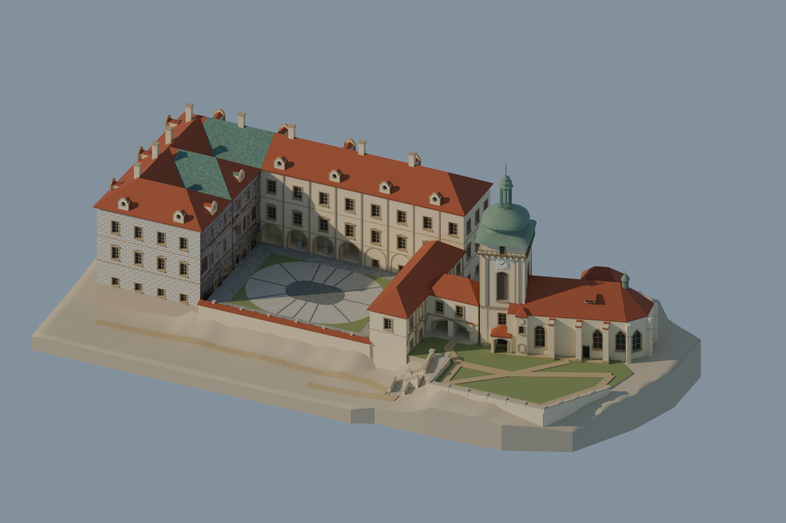
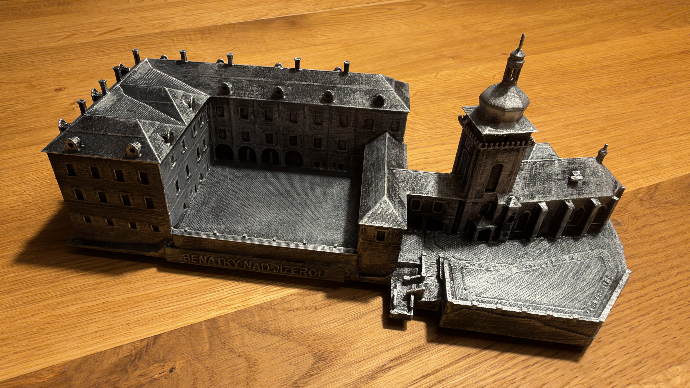
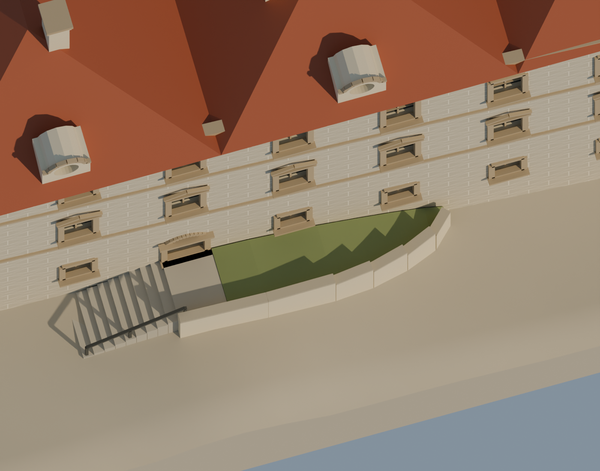
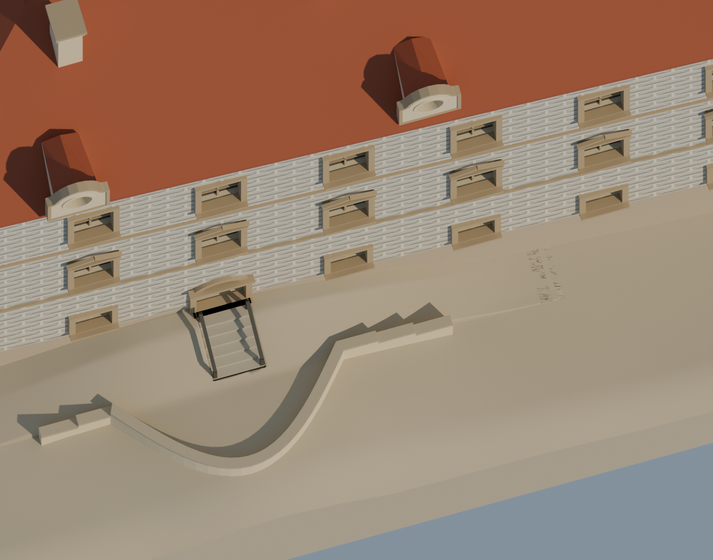

# Landmark 3D Reconstruction — skill

Sdílený postup pro AI asistenty při tvorbě a postupném zpřesňování 3D modelů skutečných staveb podle fotografií, map, plánů a výškopisných dat. Vychází z práce na zámku Benátky nad Jizerou, ale hodí se také pro kostely, věže, radnice a další landmarky.

## Ukázka výsledku

| Barevný 3D model | Skutečný 3D výtisk |
| --- | --- |
|  |  |

Vlevo je render digitálního modelu v012; vpravo fotografie fyzického výtisku dodaná Petrem Honegerem. Přesná verze a měřítko výtisku nejsou na základě fotografie ověřeny. Barevný model používá na fasádě upravenou [fotografii Martina Veselky](https://commons.wikimedia.org/wiki/File:Ben%C3%A1tky_nad_Jizerou_-_Nov%C3%A9_Ben%C3%A1tky_-_z%C3%A1mek_(1).jpg), [CC BY-SA 4.0](https://creativecommons.org/licenses/by-sa/4.0/). K dispozici je také [digitální náhled tiskové verze v012](images/benatky-tiskovy-model-v012.png). [Původ a licence obrázků](images/README.md).

## Co skill dělá

- Sestaví model od půdorysu a hmot po charakteristické detaily.
- Opakovaně srovnává model s fotografiemi ze srovnatelných pohledů, opravuje konkrétní rozdíly a kontroluje dopady na sousední části.
- Pracuje se zdroji pro terén a výšku a uvádí přesnost, souřadnicové a výškové systémy i nejistoty.
- Zachovává editovatelný master, evidenci zdrojů, verze a případný samostatný model pro tisk.

## Příklad skutečné opravy

Starší návrh schodů a opravená verze po posouzení dalšího referenčního pohledu:

| Před: model v007 | Po: model v010 |
| --- | --- |
|  |  |

Jde o digitální rendery; konkrétní referenční snímek k těmto schodům není součástí repozitáře kvůli nedoloženým právům k jeho zveřejnění. Příběh změny a její nejistoty popisují [fotografie a opravy](references/fotografie-a-opravy.md).

## Instalace a použití

Pro Codex zkopíruj obsah tohoto repozitáře do adresáře `~/.codex/skills/landmark-3d-reconstruction` tak, aby `SKILL.md` ležel přímo v tomto adresáři. Například:

```sh
git clone https://github.com/PetrMB/landmark-3d-reconstruction-skill.git ~/.codex/skills/landmark-3d-reconstruction
```

Pokud adresář již existuje, nejprve si jej zkontroluj a uchovej vlastní změny. V nové relaci můžeš použít například: „Použij $landmark-3d-reconstruction a vytvoř editovatelný model radnice podle přiložených fotografií; postupně mi ukaž kontrolní porovnání.“ Pro jiné asistenty lze předat `SKILL.md` a související adresář `references` jako pracovní instrukce; způsob instalace závisí na nástroji.

[SKILL.md](SKILL.md) · [Zdroje pro výšky a terén](references/vysky-a-zdroje.md) · [Porovnávání a příklady oprav](references/fotografie-a-opravy.md) · [Původ obrázků](images/README.md)

## Podklady a práva

Fotografie a modely používej pouze v rozsahu, který dovoluje jejich licence a konkrétní zadání. Licence se může lišit pro každý podklad. Fotografie v tomto repozitáři má licenci uvedenou u obrázku; rendery pocházejí z projektu Petra Honegera. Veřejná dostupnost jiných fotografií neznamená automatické právo je dále zveřejňovat. Textové instrukce tohoto repozitáře jsou poskytovány pod [licencí MIT](LICENSE); u obrázků platí samostatné podmínky uvedené v [images/README.md](images/README.md).
