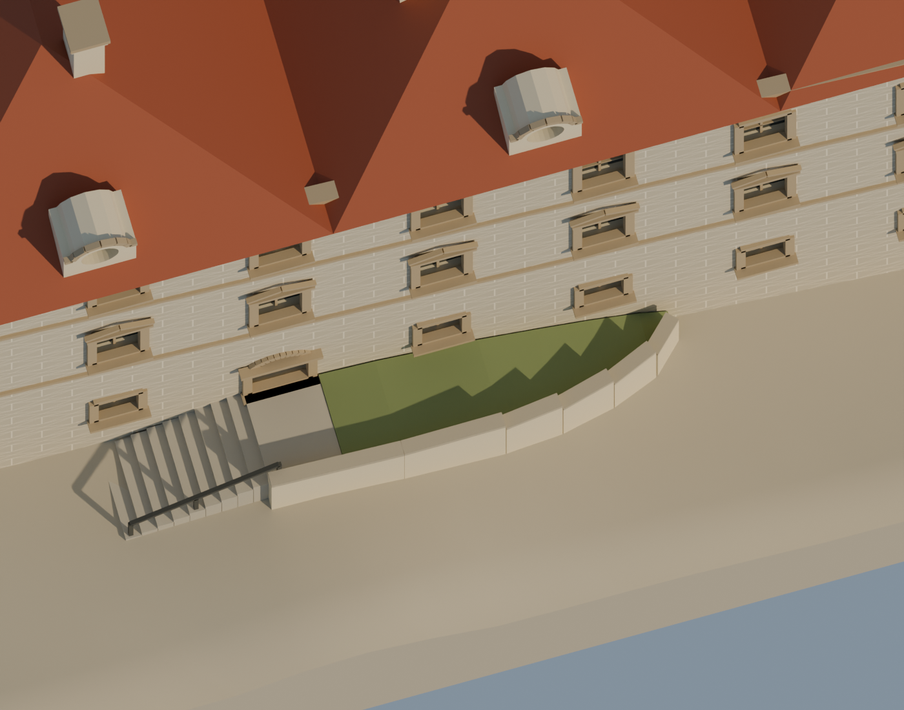
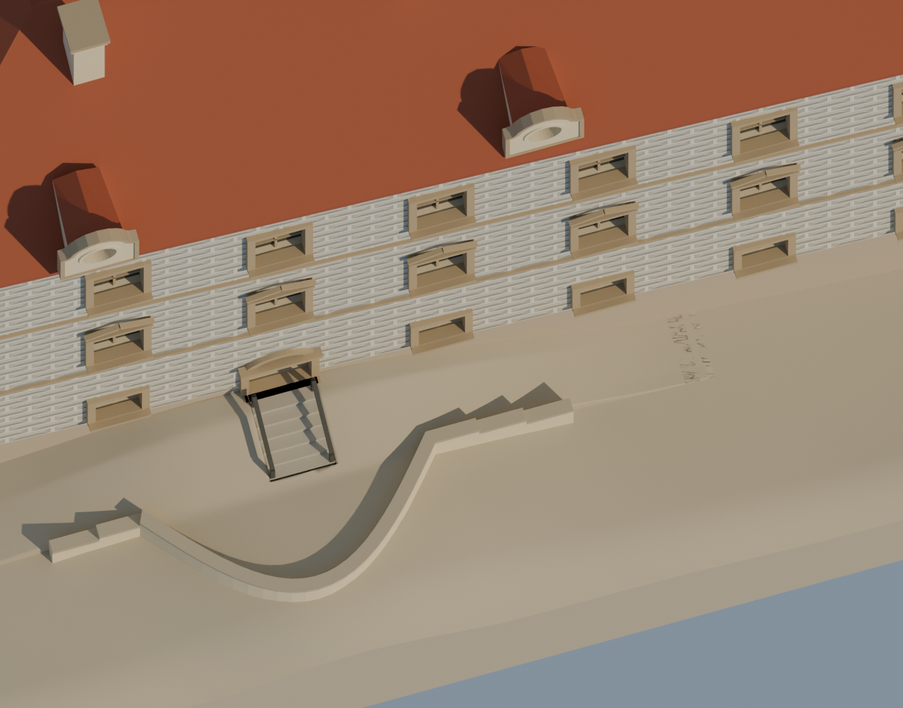

# Porovnání s fotografiemi a opravy

## Jak porovnávat

Použij fotografii, která skutečně zachycuje zkoumanou část, a zaznamenej její datum a směr. V modelu nastav co nejbližší pozici kamery a perspektivu; zarovnej více odpovídajících bodů (například rohy, hřeben a okna). Rozliš změnu perspektivy od skutečné geometrické chyby. Jeden snímek nemůže spolehlivě určit všechny rozměry ani zakryté části. Pro přímý překryv uveď případný ořez a transformaci, aby nebyly zaměněny za měření.

Kontrolní seznam: hlavní silueta a poměry; poloha a orientace křídel; výška terénu a návaznosti; hřebeny, okapy a sklony; počet a rozmístění oken; schody, zdi a vstupy; věže a jejich profil; detaily a materiály. Při závažné neshodě oprav geometrii a zkontroluj i další pohledy. Uživatelovu připomínku zaznamenej a ověř vůči dostupnému podkladu.

## Benátky nad Jizerou: skutečná revize schodiště

Původní pracovní interpretace v007 zobrazovala schody podél fasády. Při revizi podle dalšího uživatelem dodaného referenčního pohledu vznikla v010: krátké schody kolmé k fasádě a samostatná vyklenutá opěrná zeď. Přesný počet stupňů, jejich rozměry a křivka zdi zůstávají odhadem.

| Starší digitální model v007 | Opravený digitální model v010 |
| --- | --- |
|  |  |

Tyto rendery ukazují změnu interpretace, nejsou fotografiemi ani důkazem konečné přesnosti. Referenční snímek použitý pro tuto konkrétní opravu nebyl zveřejněn, protože jeho licence pro další šíření není doložena. Pracovní historie: projekt Benátky, `research/USER_CORRECTIONS.md`, oddíly 5–6 a V010. Při obdobné nejasnosti vyhledej fotografii ze strany i shora a porovnej schody, zeď a terén jako samostatné části.

## Příklad záznamu revize

| Položka | Příklad |
| --- | --- |
| Místo | Zahradní schodiště u fasády |
| Problém | Směr schodů a vztah k opěrné zdi |
| Evidence | Identifikovaná fotografie, datum a směr; další pohled shora |
| Změna | Nová geometrie schodů, samostatná zeď a upravený terén |
| Kontrola | Před/po ze stejné kamery a druhý pohled, návaznost terénu |
| Nejistota | Přesný počet a rozměry stupňů bez zaměření |

Další poučení z projektu: věž z pohledu zdola může mít zkreslený profil; ověřuj její poměry i z bočního pohledu. Textura nenahrazuje potřebný reliéf a musí být kalibrována společně s okny a geometrií.
